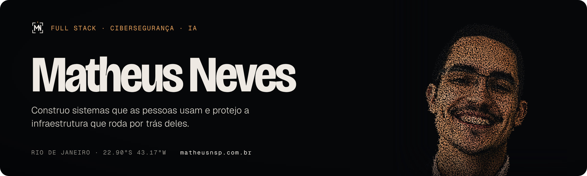
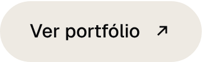
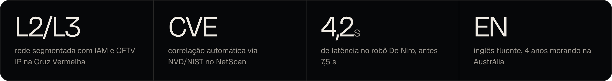
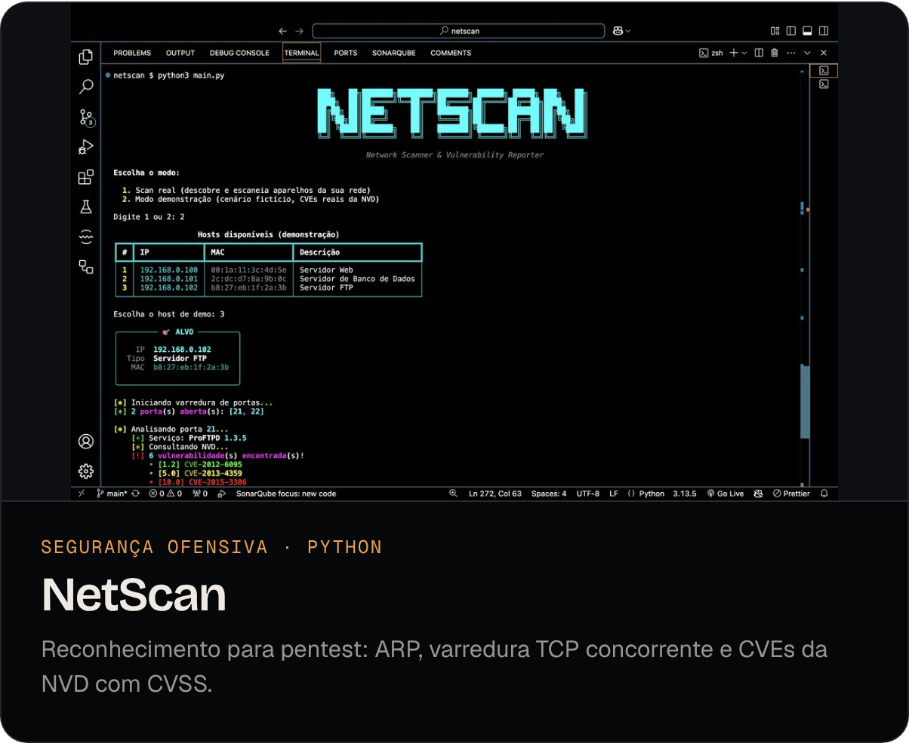
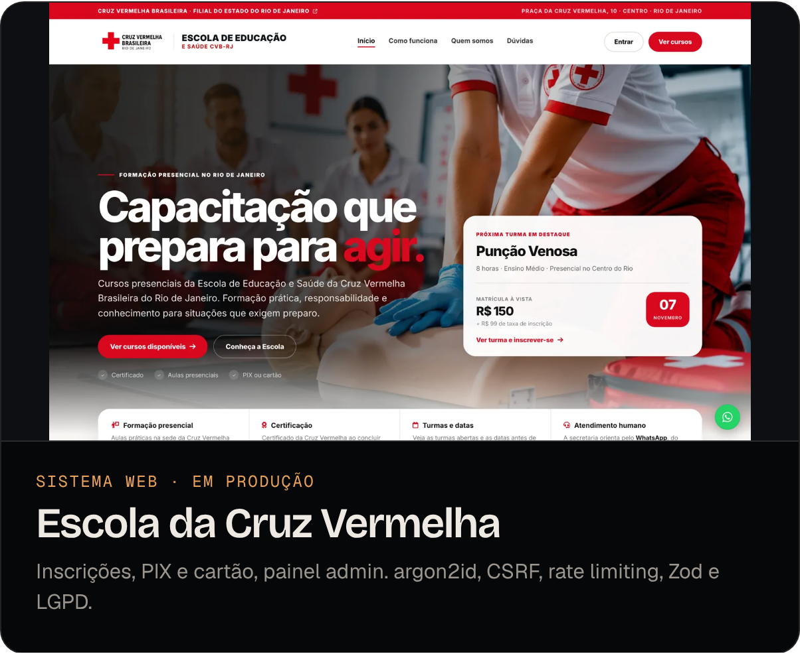
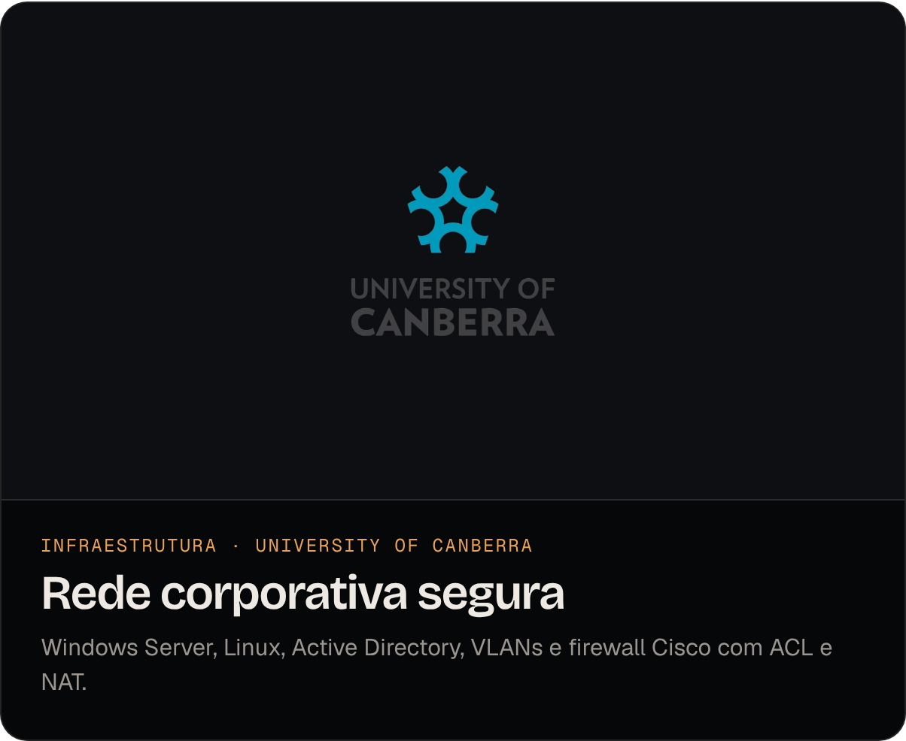
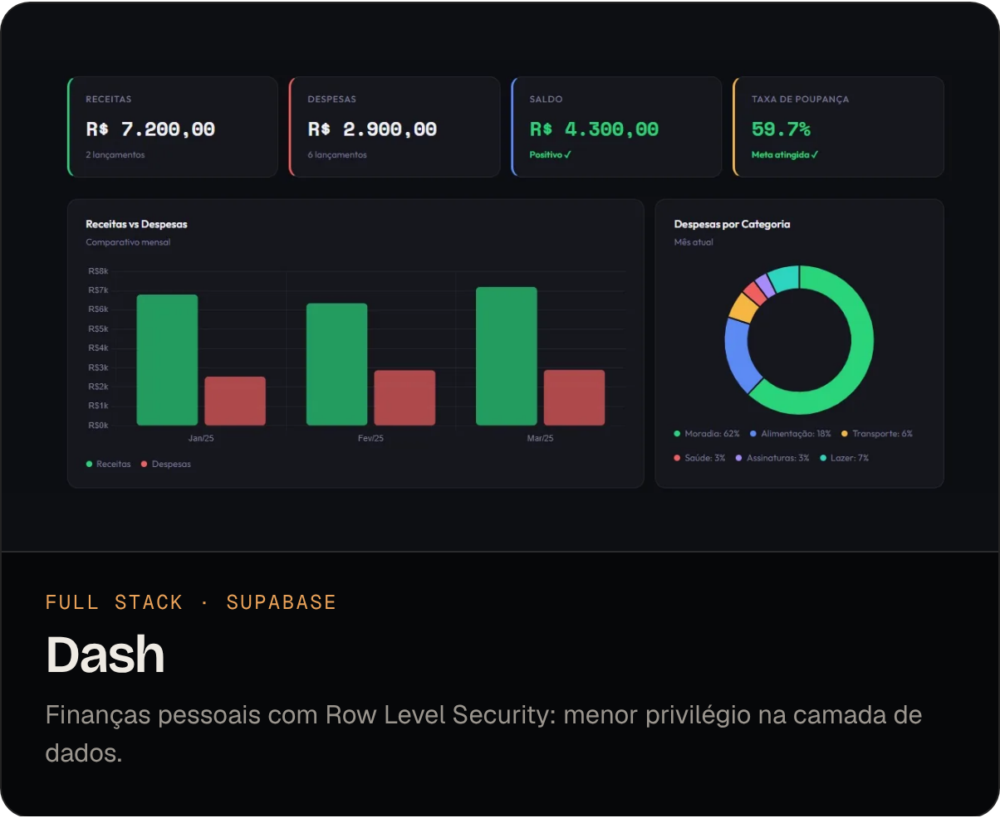
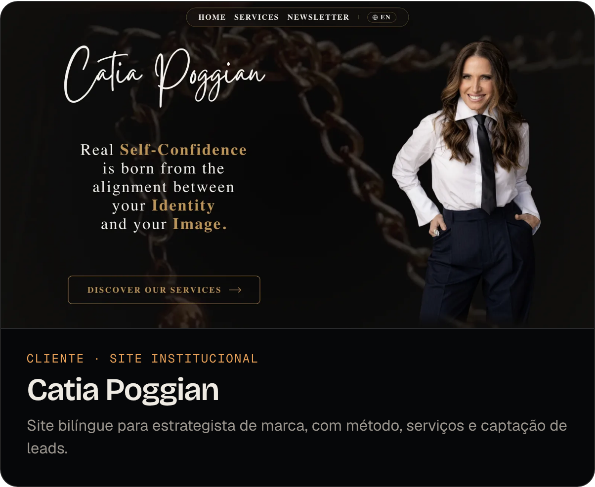
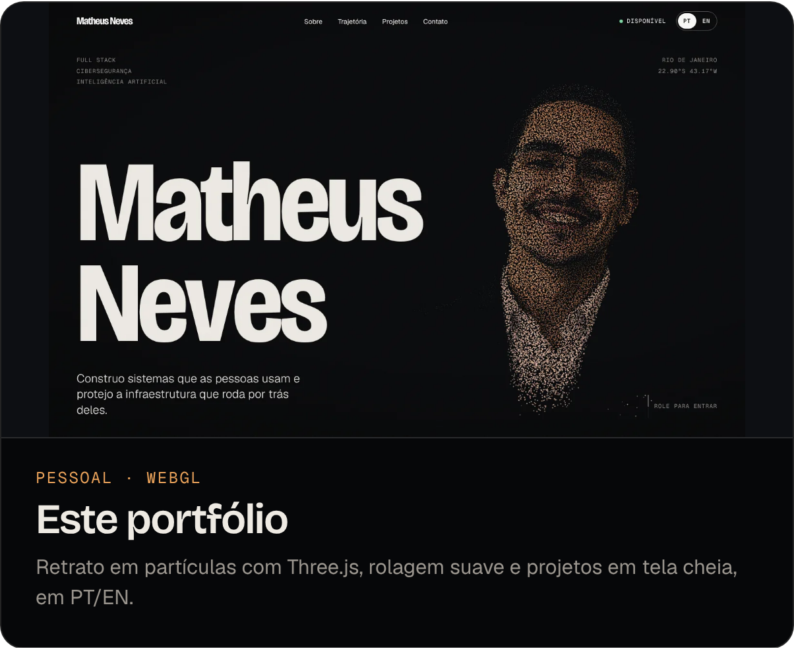
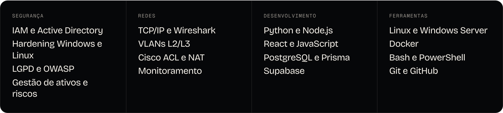

  &nbsp;
  &nbsp;
  &nbsp;
  

Engenheiro de software formado na **University of Canberra**, com ênfase em cibersegurança. Hoje coordeno infraestrutura e segurança na **Cruz Vermelha Brasileira**, no Rio, e desenvolvo sistemas web que vão para produção.

**Procuro:** vaga de Analista de Segurança da Informação Jr. (SOC N1) ou de Infraestrutura e Segurança, com foco em monitoramento, triagem de eventos e hardening de Windows e Linux. Sigo aceitando projetos web como freelancer.

## Projetos

  
  

  
  

  
  

## Trajetória

**Coordenador de Infraestrutura e Segurança (voluntário)** · Cruz Vermelha Brasileira, Rio de Janeiro · *fev 2026 – agora*
- Auditoria do parque tecnológico, controle de ativos e sanitização segura de HDDs
- Expansão e segmentação da rede (L2/L3), monitoramento remoto e CFTV IP com políticas de IAM
- Sistema de gestão da Escola de Capacitação com desenvolvimento seguro e adequação à LGPD

**Estagiário de IA e Robótica** · University of Canberra, Austrália · *jul – nov 2024*
- Plataforma com GPT-4, Whisper e ElevenLabs para um robô de teatro, latência de 7,5 s para 4,2 s
- Robô apresentado no Questacon Science Museum

**Bacharelado em Engenharia de Software** · University of Canberra, Austrália · *concluído em dez 2024 · GPA 5,67/7*

## Arsenal

## Certificações

- **CompTIA Security+ (SY0-701)** · em andamento, previsão jan 2027
- **Microsoft SC-900** · Security, Compliance & Identity Fundamentals · 2025
- **Oratória e Comunicação** · Clube da Fala · 2025

<b>English version</b>

 

Software engineer who graduated from the **University of Canberra** with a focus on cybersecurity. I run IT infrastructure and security at the **Brazilian Red Cross** in Rio de Janeiro and build web systems that ship to production.

**Looking for:** a Junior Information Security Analyst (SOC L1) or Infrastructure & Security role, focused on monitoring, event triage and Windows/Linux hardening. I also take on freelance web projects.

- **Infrastructure & Security Coordinator (Volunteer)**, Brazilian Red Cross, Rio de Janeiro (Feb 2026 – present): hardware audit, secure HDD sanitization, L2/L3 segmentation, IAM policies and IP CCTV; built the training school's management system with argon2id, CSRF protection, rate limiting, Zod validation, role-based access and LGPD compliance.
- **AI & Robotics Intern**, University of Canberra (Jul – Nov 2024): generative-AI pipeline for a theatre robot, latency cut from 7.5 s to 4.2 s; showcased at Questacon.
- **Education:** B. Software Engineering, University of Canberra (Dec 2024, GPA 5.67/7)
- **Certifications:** CompTIA Security+ (SY0-701, in progress, Jan 2027) · Microsoft SC-900 (2025)

[Portfolio](https://www.matheusnsp.com.br) · [Résumé (PDF)](https://www.matheusnsp.com.br/resume-matheus-neves.pdf) · [LinkedIn](https://www.linkedin.com/in/matheusnsp)

Rio de Janeiro · 22.90°S 43.17°W
